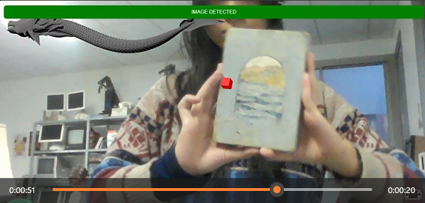
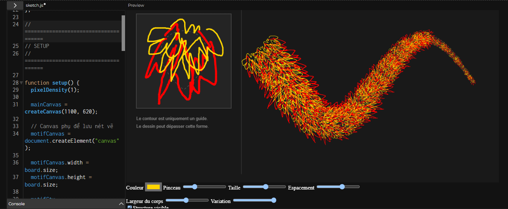

# Fiche Pédagogique

## Informations étudiant·e

- **Nom :** Nguyen

- **Prénom :** Thi Thuy Ha

## Profil et connaissances

### Présentation personnelle

// Décrivez en quelques phrases vos objectifs à court terme et à long terme, si vous en avez :

### Compétences

**CODE CRÉATIF**

**GIT ET VERSIONING**

**INTERACTIVITÉ ET RENDU TEMPS RÉEL**

**INSTALLATION ET MISE EN ESPACE**

**PRÉSENTATION ET ARGUMENTATION**

## Projets

### Projet 1

#### Sujet du projet

- **Titre du projet :**
- **Description du projet (environ 150 mots) :**

#### Thématiques de recherche

- **Thématiques que vous souhaitez explorer :**
- **Pourquoi cette thématique vous intéresse-t-elle ? (environ 100 mots) :**

#### Outils et techniques

- **Outils que vous comptez utiliser (logiciels, langages de programmation, etc.) :**
- **Techniques spécifiques que vous souhaitez maîtriser ou expérimenter :**

#### Références artistiques

- **Argumentaire expliquant la pertinence de votre projet (environ 150 mots) :**
- **Références artistiques qui inspirent votre travail (livres, artistes, œuvres, etc.) :**

## Actions

### Présentation orale d'un sujet artistique ou design (documentation de recherche)

// Sujet choisi, membres du groupe, date de passage et lien vers votre présentation :

### Accrochage de rendu

// Décrivez ce que vous allez présenter et comment vous comptez le mettre en espace :

### Contribution au logiciel

// Décrivez votre participation à la conception de l'outil commun et votre réflexion sur le sens du logiciel :

## Planification

### Planning de travail

- Établissez un planning des étapes clés de votre projet :
  - **Étape 1 :** date et description
  - **Étape 2 :** date et description
  - **Étape 3 :** date et description

## Commentaires et questions

// Avez-vous des questions ou des préoccupations à propos du cours ou de vos projets ? :

## Journal de bord

Ajoutez une entrée à chaque jour de cours, la plus récente en haut.

### JJ/MM/AAAA

- **Ce que j'ai fait :**
- **Problèmes rencontrés :**
- **Prochaine étape :**
- **Captures / liens :**

23.11
**Context du sujet:** 
Mon projet s'intéresse à la recherche de soi, à la manière dont notre identité se construit et évolue avec nos expériences, tout en gardant un lien avec nos origines.
Thématique: Identité personnelle, origines, mémoire et transformation,...	
Def 
Le dragon est une créature mythologique présente dans différentes cultures. Son apparence et sa signification varient selon les traditions. Au Vietnam, le dragon est notamment associé à la puissance, à la nature et aux origines. Il occupe une place importante dans la culture et l’art traditionnel.
Pourquoi
J’ai choisi le dragon parce qu’il fait partie de mon héritage culturel vietnamien. C’est un symbole (populaire) qui me permet d’aborder les questions d’origine, de mémoire et d’identité personnelle. Je souhaite aussi explorer sa forme, ses mouvements et ses possibilités de transformation à travers le dessin, l’animation et les outils numériques.
context
à la recherche de l’identité personnelle: comprendre d’où l’on vient, ce qui nous définit et comment notre identité évolue avec nos expériences. Le dragon représente un lien symbolique avec mes origines. Il accompagne cette réflexion sans que le projet soit uniquement centré sur la culture vietnamienne.
// Dans les représentations traditionnelles vietnamiennes, le dragon possède généralement un corps long et sinueux, sans ailes. Il peut symboliser la puissance, la prospérité et les origines. Dans de nombreuses représentations occidentales, notamment françaises, le dragon est souvent représenté avec des ailes et associé à une créature dangereuse // Je ne cherche pas à reproduire un dragon traditionnel, mais à développer ma propre interprétation.

Projet 1: 

img tracking script: https://hiukim.github.io/mind-ar-js-doc/  https://www.jsdelivr.com/package/npm/mind-ar 

Generate dragon scale
link p5js: https://editor.p5js.org/ThuyHa/full/9R1mwE9gJ

